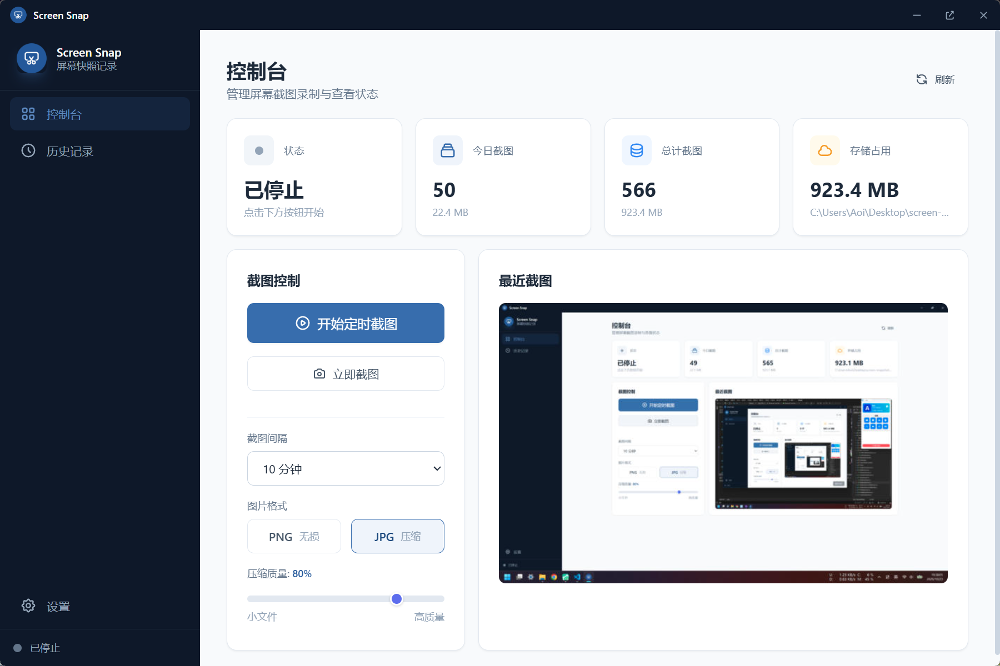
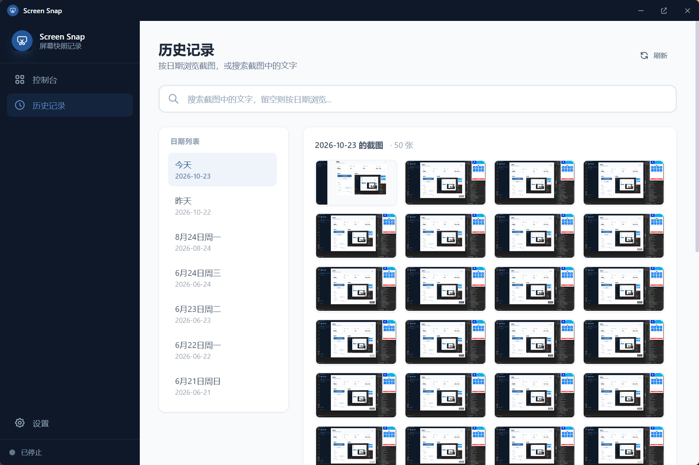
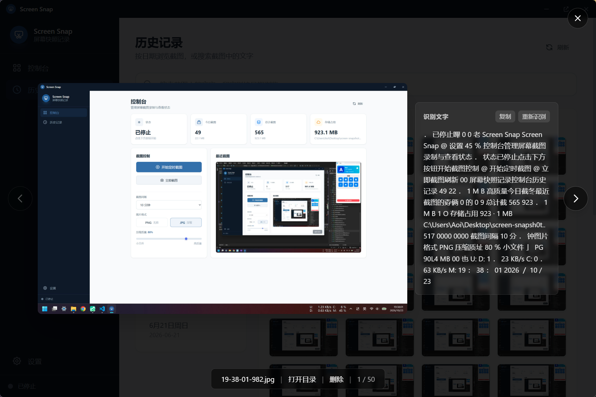
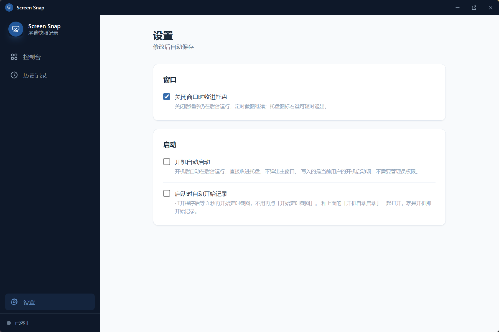

# Screen Snap

> 定时屏幕快照 + 文字索引的 Windows 桌面工具

[](https://www.microsoft.com/windows) [](https://tauri.app) [](https://vuejs.org) [](https://www.rust-lang.org) [](#许可)

按设定间隔自动截屏，异步识别画面中的文字，支持按日期浏览、关键词检索、图片预览与文字复制。
全程本地运行，不联网、不上传，数据保存在程序同目录，**便携免安装**。






---

## 特性

### 截屏

- **定时截屏**：间隔、格式（JPG/PNG）、质量均可调，最短 1 秒
- **重复画面自动跳过**：把整屏压成 64×36 灰度指纹，与上一张比对，平均像素差 < 2 就丢弃，不写盘、不 OCR
- **开机自启**：写入 `HKCU\Software\Microsoft\Windows\CurrentVersion\Run`，不需要管理员权限
- **启动即记录**：可选开机后等 3 秒自动开始，给桌面和显卡驱动留出就绪时间

### 检索

- **自动 OCR**：使用系统自带的 `Windows.Media.Ocr`，不下载模型、不占额外空间
- **关键词搜索**：中文无需分词，直接子串匹配；搜索框留空即切换为按日期浏览
- **文字可读**：识别结果保留换行、去掉汉字间的多余空格（`腾 讠 丑 会 议` → `腾讠丑会议`）
- **灯箱预览**：原图按需加载，左右翻页，支持复制文字与手动重新识别

### 系统集成

- **托盘常驻**：左键切换显示/隐藏，右键菜单可显示或退出
- **关闭收进托盘**：默认行为，可在设置里改成直接退出
- **单实例**：第二次启动不会开出第二个进程，而是把已有窗口唤到前台
- **便携数据**：截图、数据库、配置全在 exe 同级目录，整个文件夹拷走即可迁移

---

## 技术栈

| 层 | 选型 | 说明 |
|---|---|---|
| 外壳 | Tauri 2 | 二进制体积小，直接用系统 WebView2 |
| 前端 | Vue 3 + TypeScript + Pinia + Vue Router | 组合式 API，无 UI 框架，样式用 Tailwind CSS |
| 截屏 | `screenshots` crate | 直接取 RGBA 缓冲区，零拷贝移交 |
| 图像 | `image` crate | 编码、缩放、指纹计算 |
| OCR | `Windows.Media.Ocr` | 系统自带 WinRT 引擎，通过 `windows` crate 调用 |
| 存储 | 文件系统 + SQLite（`rusqlite` bundled） | 图片落盘，OCR 文本入库 |
| 自启 | `winreg` | 直接读写注册表，不启动 `reg.exe` 子进程 |
| 单实例 | `tauri-plugin-single-instance` | 命名互斥量 + IPC 转发启动参数 |

---

## 快速开始

### 前置要求

- Windows 10 1809+ / Windows 11
- [WebView2 Runtime](https://developer.microsoft.com/microsoft-edge/webview2/)（Win11 已内置，Win10 通常随 Edge 安装）
- [Rust](https://rustup.rs/)（stable，含 MSVC 工具链）
- [Node.js](https://nodejs.org/) 18+

### 开发

```bash
npm install
npm run tauri dev
```

首次编译需要拉取并优化全部依赖（`Cargo.toml` 里把 dev 依赖也设成了 `opt-level = 3`，
因为 image / screenshots 这类纯计算 crate 不优化会慢几十倍），大概几分钟到十几分钟；
之后的增量编译在几十秒内。

### 打包

```bash
npm run tauri build
```

产物在 `src-tauri/target/release/`。若只需要可执行文件，`npm run build` 后再执行
`cargo build --release`（在 `src-tauri/` 下）也可以，但注意**单独跑 `cargo build --release`
不会重新嵌入前端产物**，改了界面要重新 `npm run build` 并 touch 一下 Rust 源码，
或者直接用 `npm run tauri build`。

---

## 数据与配置

### 目录布局（便携模式）

所有运行时数据都在 **exe 同目录**，不写 `AppData`：

```
<exe 所在目录>/
├─ screen-snapshot.exe
├─ ocr.db                    # SQLite：OCR 文本索引
├─ settings.json             # 截图间隔 / 格式 / 质量 / 行为开关
├─ startup-error.log         # 仅启动失败时生成
└─ screenshots/
   ├─ 2026-10-23/
   │  ├─ 17-29-55-536.jpg    # 原图，毫秒级时间戳，同秒多张也不会重名
   │  └─ ...
   └─ .thumbs/                # 列表与预览用的缩略图缓存，可随时删除
      └─ 2026-10-23/
         └─ 17-29-55-536.jpg
```

> **注意**：数据跟着程序走。不要对 exe 所在目录做覆盖安装或清理，
> `cargo clean` 或删除 `target/` 会连同截图一起删掉。

### settings.json

```json
{
  "interval_secs": 600,
  "format": "jpg",
  "quality": 80,
  "close_to_tray": true,
  "auto_start_capture": false
}
```

| 字段 | 类型 | 默认值 | 说明 |
|---|---|---|---|
| `interval_secs` | number | `10` | 截屏间隔（秒），后端限制在 1 ~ 86400 |
| `format` | string | `"jpg"` | `jpg` 或 `png` |
| `quality` | number | `80` | JPG 质量 1~100，PNG 忽略 |
| `close_to_tray` | bool | `true` | 关闭窗口时收进托盘；`false` 则直接退出 |
| `auto_start_capture` | bool | `false` | 程序启动后自动开始定时截图（延迟 3 秒） |

字段缺省时自动取默认值，手写配置不用写全。

### 数据库

```sql
CREATE TABLE ocr_results (
  filepath    TEXT UNIQUE NOT NULL,   -- 截图绝对路径
  ocr_text    TEXT NOT NULL DEFAULT '', -- 去空白文本，用于搜索
  ocr_display TEXT NOT NULL DEFAULT '', -- 保留换行，用于阅读/复制
  captured_at TEXT NOT NULL DEFAULT ''  -- 识别时间
);
```

分两列存是因为两者的需求冲突：搜索要抹掉换行（否则关键词会被行尾切断），
阅读又需要换行。老库启动时自动 `ALTER TABLE` 补列，无需手动迁移。

---

## 项目结构

```
screen-snapshot/
├─ src/                        前端
│  ├─ App.vue                  无边框窗口、自定义标题栏、托盘提示
│  ├─ views/
│  │  ├─ Dashboard.vue         控制台：状态卡片、截图控制、最近截图
│  │  ├─ History.vue           历史记录：日期列表 + 网格 + 灯箱 + 搜索
│  │  └─ Settings.vue          设置：间隔/格式/质量/托盘/自启/自动记录
│  ├─ components/Sidebar.vue   侧栏导航
│  ├─ stores/                  Pinia：capture / settings / search
│  ├─ composables/useImageCache.ts  缩略图与原图缓存（带容量上限）
│  └─ assets/app-icon.png      界面用图标（与安装包图标同源）
│
└─ src-tauri/                  后端
   ├─ src/main.rs              命令、定时循环、托盘、自启、单实例
   ├─ src/screenshot.rs        截屏、编码、缩略图、相似度指纹
   ├─ src/ocr.rs               WinRT OCR 封装
   ├─ src/db.rs                SQLite
   ├─ icons/                   安装包与托盘图标（改图标从这里换）
   └─ tauri.conf.json          窗口、打包、CSP 配置
```

---

## 实现说明

### 截屏管线

一次截屏拆成「快路径」和「慢路径」，保证定时器不被编码拖慢：

```
定时器触发
   └─ capture_quick()           几十毫秒
        ├─ 抓屏 → RGBA 缓冲区
        ├─ 指纹比对 → 重复则直接丢弃
        ├─ 生成 640px 缩略图
        └─ 返回预览（base64）+ 待落盘数据
             └─ 后台任务
                  ├─ 原图编码写盘      ← 最慢的一步
                  ├─ 缩略图写盘
                  └─ OCR → 写库
```

- 截屏与 OCR 全部在阻塞线程池执行，不占用 tokio worker
- OCR 用信号量串行，避免短间隔下任务堆积
- 列表与预览只传 640px 缩略图（几十 KB），原图仅在灯箱按需读取

### 重复画面判定

整屏缩到 **64×36 灰度**（2304 个采样点）作为指纹，与上一张已保存的指纹求平均像素差（MAD）：

| 场景 | 实测 MAD |
|---|---|
| 同一张图 | 0.000 |
| 只有任务栏时钟变化 | 0.002 |
| 只有光标闪烁 | 0.000 |
| 换成另一个页面 | 123.8 |

阈值取 `2.0`，两端都有 60 倍以上余量。因为比的是降采样结果，时钟、光标这类细微变化会被平均掉，
而页面结构变化会明显体现。手动截图与定时截图共用同一份判断基准；删除截图时会清空指纹，
否则删掉最后一张后同一屏就再也截不回来。

### OCR

- 直接把原图字节交给 `BitmapDecoder`，不做「解码 → 编码 BMP → 再解码」的往返
- 引擎全局复用（`OnceLock`），引擎创建开销约 5 ms
- 实测单张 2560×1600 截图：解码 27 ms + 识别 236 ms，瓶颈在识别本身

### 搜索

`ocr_text` 存的是去掉所有空白的文本，关键词也做同样处理后再 `LIKE` 匹配，
这样「会 议」和「会议」、跨行的关键词都能命中。结果按 `captured_at` 倒序，上限 200 条。

### 系统集成

- **托盘**：左键切换窗口显隐；右键菜单「显示主窗口 / 退出」
- **自启**：注册表值 `ScreenSnap` 写入当前 exe 路径 + `--autostart` 参数；
  每次启动只要自启是开着的，都会把路径刷新成当前 exe（便携版换目录后依然有效）
- **单实例**：第二个实例启动时被插件拦下，转发参数给第一个实例，
  第一个实例把窗口 `show + unminimize + focus`；若是开机启动触发的重复实例则保持安静

---

## 快捷键

| 场景 | 按键 | 作用 |
|---|---|---|
| 图片预览 | `←` / `→` | 上一张 / 下一张 |
| 图片预览 | `Esc` | 关闭预览 |

---

## 已知限制

- **仅支持 Windows**：截屏走 GDI，OCR 走 WinRT，没有跨平台实现
- **只截主显示器**：多屏环境下只抓第一个屏幕
- **OCR 准确率受限于系统引擎**：对密集小字号的界面文本识别率一般
  （例如「腾讯会议」可能被识别成「腾讠丑会议」）。要提升需要换 PaddleOCR / RapidOCR
  这类带模型文件的引擎，代价是体积和内存上涨
- **重复判定只和上一张比**：画面在 A、B 之间来回切换时，每次切换都会各存一张
- **历史截图不会自动清理**：需要手动删除，没有按保留天数/容量自动回收

---

## 许可

暂未指定开源许可。如需开源，建议补充 `LICENSE` 文件（MIT / Apache-2.0 均可）。
